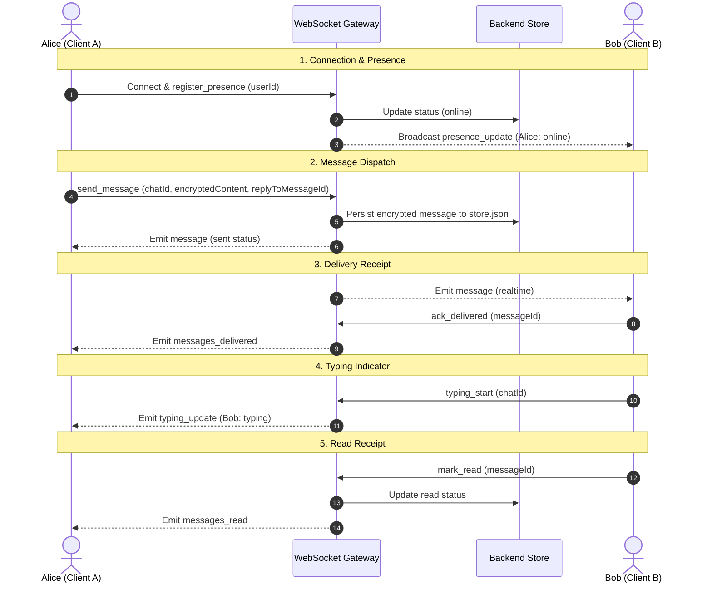

# Secret Chat Application Overview & Architecture Report

This report outlines the implemented features, workflow, monorepo architecture, and local verification status of the Secure Secret Chat App workspace.

---

## 1. Browser Execution Check

The backend and frontend dev servers are fully operational, and the application has been successfully verified in the browser.

### Verification Results
- **Smoke Tests**: Built successfully and passed runtime assertions (isolated port `3302`).
- **Dev Servers**: Concurrently running in the background:
  - React Web Client: [http://localhost:5173/](http://localhost:5173/)
  - NestJS API & WebSocket Backend: [http://localhost:3000](http://localhost:3000)
- **Browser Interaction Checklist**:
  - [x] Navigate to http://localhost:5173/ and check if running
  - [x] Click 'Quick Dev Login' and wait for profile to load
  - [x] Click 'Contacts' tab
  - [x] Verify contacts list (search 'admin' or empty search)
  - [x] Click 'Settings' tab
  - [x] Verify responsiveness and realtime elements
  - [x] Generate final report

### Visual Proof

Here is the initial landing page loaded by the browser automation agent:


Here is the contacts tab view populated with default contacts:


Here is the recorded video demonstration of the browser verification flow:


---

## 2. Implemented Features Summary

The application supports a rich set of Telegram-style features across user and admin roles:

### Core Chat Features
- **Secure Authentication**: Traditional Sign Up/Sign In, along with a **Quick Dev Login** button for testing.
- **One-to-One Chat Creation**: Search users by name/phone/email and initialize 1-to-1 chat threads.
- **Realtime Messaging**: Instant message exchange via Socket.IO.
- **File & Image Attachments**: Support for image, video, audio, and generic files (up to 25MB).
- **Message Controls**:
  - **Edit Message**: Inline editing of sent messages with updated timestamp updates.
  - **Pin & Unpin**: Pin a message to the top of the chat window.
  - **Replies**: Context-preserving replies to existing messages.
  - **Emoji Reactions**: React to message bubbles with quick emojis (👍, ❤️, 😂).
- **Security & Erasure Flow**:
  - **Delete Request & Approval**: Message/Chat deletion is handled securely; requesting deletion alerts the other user, requiring their approval to complete the erasure.
- **Presence & Receipts**:
  - **Realtime Status**: Visual indication of online/offline status and "last seen" timestamps.
  - **Typing Indicator**: Realtime notification when the other user starts typing.
  - **Receipt Tracking**: `sent` -> `delivered` -> `read` visual indicators on message bubbles.
- **Communities**: Group spaces creation and public/private listing.

### Admin Web Mode
- Accessible via the **Admin Web** toggle in the header (Credentials: `admin` / `admin123`).
- **Dashboard Tabs**:
  - **Overview**: App statistics (total users, chats, messages, etc.).
  - **Users**: List of registered users.
  - **Chats**: Active chat threads list.
  - **Messages**: Complete message audit list.
  - **Communities**: Group listings.
  - **Delete Requests**: Pending/Approved/Rejected message erasure requests.

---

## 3. Workflow & Lifecycle

The lifecycle of communications within the app follows a standard sequence:



### Key Workflows:
1. **Quick Dev Login**: Bypasses full verification and logs in using pre-configured mock credentials (defaults to User One: `9000000001` / `secret123`).
2. **Delivery & Read Pipeline**:
   - When Alice sends a message, it is marked as `sent`.
   - If Bob is connected to the namespace, the gateway pushes the message and automatically triggers an `ack_delivered` event, updating Alice's client to show the message as `delivered`.
   - Once Bob opens/focuses the chat pane, the client fires a `mark_read` event to the gateway, updating Alice's client to show the message as `read`.
3. **Delete Request Process**:
   - Instead of immediately deleting a chat, a member initiates a deletion request.
   - A `PENDING` request is logged in the backend store.
   - The other member receives a conspicuous popup prompt to either `Approve` or `Reject` the request.
   - If approved, the chat history is purged. If rejected, a notice is displayed to the requesting user.

---

## 4. Software Architecture

The workspace is structured as an npm workspaces monorepo:

```
├── apps
│   ├── backend     # NestJS WebSocket and API Server
│   ├── web         # React / Vite Client
│   └── mobile      # React Native Starter
├── packages
│   └── shared      # Common Type Definitions
└── scripts         # Test and build tools
```

### Components and Technologies:

1. **NestJS Backend (`apps/backend`)**
   - **Main Entrypoint (`src/main.ts`)**: Initializes the NestJS application on port `3000` with CORS enabled.
   - **WebSocket Gateway (`src/websocket/chat.gateway.ts`)**: Socket.IO gateway namespace `/chat` implementing listeners and dispatchers for realtime events.
   - **InMemoryStore (`src/store/in-memory.store.ts`)**: Handles local data structures in memory. Periodically flushes states to the local disk file `apps/backend/data/store.json` for lightweight persistence.
   - **Controllers**:
     - `auth.controller.ts`: Registration, standard login, admin login, and dev-login routes.
     - `chats.controller.ts`, `messages.controller.ts`, `communities.controller.ts`, `users.controller.ts`: REST endpoints.
     - `uploads.controller.ts`: Local attachment storage (`/uploads/:fileName`).

2. **React Web Client (`apps/web`)**
   - Built on **Vite** and **React** for fast developer turnaround and lightweight production bundle size.
   - **CSS Stylesheets (`src/styles.css`)**: Vanilla CSS styling featuring fluid desktop and mobile-responsive panels, dark mode, overlay notifications, and modern bubble layout.
   - **State Manager (`src/App.tsx`)**: Contains layout tabs (Chats, Contacts, Settings, Admin mode), forms, message triggers, search handling, reactions, and responsive views.
   - **Socket Wrapper (`src/socket.ts`)**: Initializes Socket.IO client connection to namespace `http://localhost:3000/chat`.
   - **API Connector (`src/api.ts`)**: Wraps native `fetch` requests with JSON headers and utility error interceptors.

3. **Shared Types (`packages/shared`)**
   - Unifies typescript interface definitions for `User`, `Chat`, `Message`, `DeleteRequest`, `Community`, and WebSocket protocols.

4. **Bi-Directional Encryption Strategy**
   - In its current development state, the encryption layer (`src/crypto.ts`) acts as a placeholder implementing base64 obfuscation. A hook system is prepared for full libsignal protocol end-to-end encryption in a production release.

---

## 5. Account Suspension, Recovery & AI Verification System (New)

### Suspension Pipeline & Data Preservation:
- **Deactivation vs. Deletion**: User-initiated "Delete Account" actions (via Settings or Profile Panels) are converted to a soft-suspension. This sets user `status: "SUSPENDED"`, logs suspension reasons, and locks auth.
- **Admin Actions**: Administrators have dual powers in the user console:
  - **🚫 Suspend**: Locks a user out with a specified policy reason.
  - **✅ Restore**: Re-activates the account.
  - **🗑 Delete**: Hard-deletes all messages, chats, and records permanently.

### AI Verification Pipeline:
1. **Recovery Request Form**: User supplies text detailing reinstatement context.
2. **Aadhaar OCR Simulation**: Extracted face and name are cross-checked; sensitive Aadhaar numbers are explicitly ignored to respect privacy.
3. **Biometric Face Match**: Compares face on Aadhaar card against captured 3-second video frames.
4. **AI Decision Report**: Generates matching score (e.g. `91%`), name validation, and output (`AUTHORIZED` or `NOT AUTHORIZED`).
5. **Admin Queue**: Admin views the full AI verification report without raw document storage, enabling one-click Approve/Reject actions.

### Dynamic Database Resolution:
- Autodetects context paths (root or workspace subdirectories) to ensure the database file maps reliably to `apps/backend/data/store.json`, preventing data loss or split database files.

### Service Controller Batch script:
- Includes `start-stop-server.bat` in the root workspace folder, providing one-click command-line actions to status check ports, start concurrent services, and kill active node instances cleanly.
